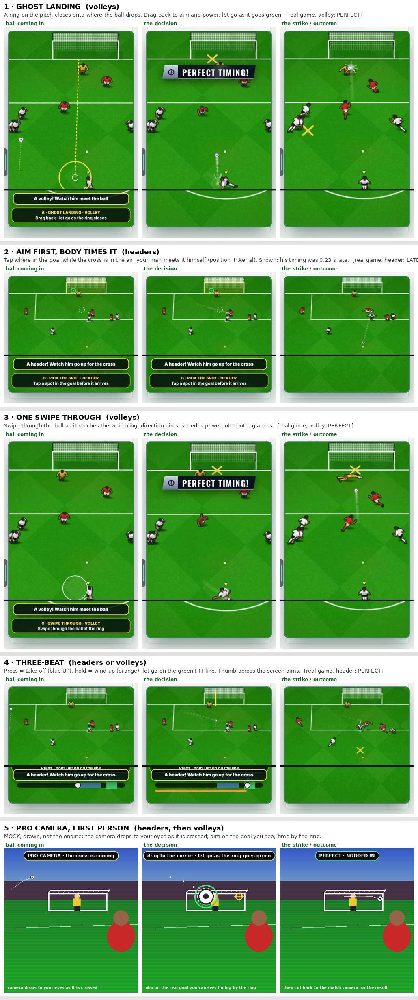
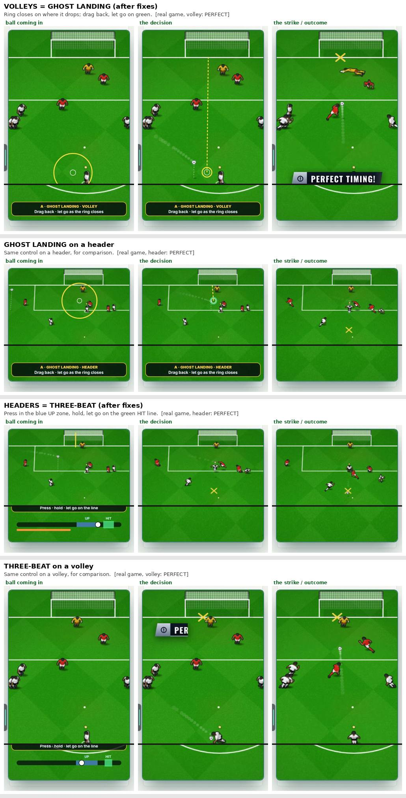

# Headers and volleys: five ways to decide WHEN and HOW you hit it (28 Nov 2026)

Harry, 12:08: "the headers and volleys system just has never worked with WHEN you hit the ball, I think we need to think of different ideas of how this could work."
Harry, 12:10: "show me visuals of each 5 starting ideas … they also can be separate different mechanics … an idea was have it be like pro camera from FIFA."

The audit of today's system is in `VOLLEYS_HEADERS_AUDIT_2026-11-28.md`.

**My recommendation:**
- **Headers = Three-beat (4).**
- **Volleys = Ghost landing (1).**
- **Pro camera (5): later, as a showcase.**
Harry picks. Then we wire the winner into matches and drills.

## Try them

Harry, 12:20: "just make that into a test page, will come back to that soon." So this is parked on the test page. Nothing has gone into matches or drills.

To try them:
1. Open `/star-aerials-dev` (it is in the admin menu).
2. In panel "1 · How you hit it", pick one: Today, 1 Landing ring, 2 Aim first, 3 Swipe through, 4 Tap-hold-release, or 5 Pro camera. Pro camera shows its drawn frames and a "not built yet" note.
3. Press "Header chance" or "Volley chance". "Replay" plays the same chance again; "New chance" gives a fresh one.

The page shows each idea's bot numbers. The admin eye button (PageGuide) explains every button.
You can also open it straight on one idea: `/star-aerials-dev?control=ghost` (or `preaim`, `swipe`, `beat`, `procam`).
In the code the ideas keep their working names: ghost = 1, preaim = 2, swipe = 3, beat = 4.

Ideas 1 to 4 play on the real engine (EnginePlay; the one-engine guard passes):
- The whole cross comes in on the pitch, on one clock: it reaches you at time D.
- The idea only decides the aim, the power, and where and when the ball is met.
- The strike then goes through the match's own `handleContact` (launch, applyAirborne, airContactRead), as the ball screen's does.
- A test switch (`setTestAirControl`) is set only while the page is open. The live match is unchanged.

The timing rule is the same for all four:
- **Clean (PERFECT):** within ±0.13 s of the ball reaching you (header, Aerial 60). The window is 0.10 s at Aerial 30 and 0.16 s at Aerial 90.
- **Volleys:** 0.7 of that window. A dropping ball met with the foot is harder to time.
- **Early:** you get under it. A header loops up; a volley balloons.
- **Late:** you catch its edge. A header glances; a volley is scuffed.
- **More than 3 windows off:** you missed the timing. It is the old screen's late touch.

Rows 1 to 4 are frames from the real game, at phone size. Row 5 is a drawn mock-up.

## Side by side

How sure each part is:
- **Measured:** the goals and clean-hit rates. They come from `scripts/aerial/control-measure.mts`, 400 chances per cell, on the pictures the game serves, through the engine's own strike.
- **Assumed:** the bot's thumb errors (`AVERAGE_THUMB` in `lib/star/airControl.ts`). They are not measured on people.
- **Shown:** the time to the hit is the cross's own flight, about 1.6 to 1.7 s, for every idea. With today's ball screen the strike screen opens 0.6 to 1.2 s in, before the ball has visibly arrived.

| Idea | Feel on a phone | Suits | Goals /100 at Aerial 30 / 60 / 90 | Clean hits at Aerial 60 |
|---|---|---|---|---|
| Today: ball screen | Cross, then a blue screen with a ring | (both) | header 13 / 22 / 28 · volley 16 / 24 / 29 | (ring ran out 10 / 17 per 100) |
| 1 · Ghost landing | A ring on the pitch closes onto where you meet it. Drag back to aim and power, let go as it goes green. The ground shot you know, plus a beat you can read. | **Volleys** (where it drops IS the volley) | header 13 / 18 / 27 · volley 30 / 36 / 44 | header 83% · volley 70% |
| 2 · Aim first, body times it | Tap where in the goal while it is in the air. Your man meets it himself (Aerial sets his timing). One tap, no timing for you. | Headers | header 9 / 15 / 23 · volley 21 / 29 / 41 | header 70% · volley 52% |
| 3 · One swipe through | Swipe through the ball as it reaches the ring. Direction aims it, speed is power. | Volleys | header 8 / 14 / 16 · volley 18 / 23 / 28 | header 72% · volley 53% |
| 4 · Three-beat | Press = take off (blue UP zone), hold = wind up, let go on the green HIT line. Your thumb's place across the screen aims it. | **Headers** (jump, hang, nod), volleys too | header 10 / 15 / 22 · volley 25 / 30 / 37 | header 88% · volley 75% |
| 5 · Pro camera | The camera drops to your eyes as it is crossed. You see it fly at you and aim on the goal you can see. | Headers, then volleys | not built | – |

### How each one works on the engine, how skill shows, how you miss

1. **Ghost landing**
   - **Input:** the drag back sets the aim (sideways) and the power (length). Letting go is the hit.
   - **Skill:** Aerial widens the green window.
   - **Miss:** let go early or late, or aim wide.
   - **One thumb:** yes.
   - **Code:** `ghostStrike`.
2. **Aim first, body times it**
   - **Input:** you tap the goal: left to right is the aim, high or low means nodded down or met through the middle.
   - **Skill:** your man's own timing error comes from Aerial: an sd of 0.17 s at 30, 0.12 at 60, 0.08 at 90. That makes it the most stat-driven of the five.
   - **Miss:** your man's timing is off; you cannot save it.
   - **One thumb:** yes, the easiest.
   - **Code:** `preaimStrike`.
   - **Not built:** Harry's "body position" version (you steer him under the landing spot). It would replace the Aerial roll with where you put him.
3. **One swipe through**
   - **Input:** the swipe's direction aims it (18° off straight up = the post), its speed is the power, and passing off-centre means a glance. The moment it passes the ball is the timing.
   - **Miss:** off-centre or mistimed.
   - **Risks:** the least accurate (the worst header numbers), and a swipe can be confused with the drag you use for a normal shot.
   - **Code:** `swipeStrike`.
4. **Three-beat**
   - **Input:** pressing late (after the blue zone) means you are not up in time; that counts as late. The hold sets the power. The release is the hit.
   - **Skill:** Aerial widens the green HIT block.
   - **Why it rates well:** a bar you can read gives the steadiest timing.
   - **One thumb:** yes.
   - **Code:** `beatStrike`.
5. **Pro camera (honest effort)**
   - The 3D match view (`lib/star/style3d/engineView.ts`, through `Match3DLayer`) already draws every frame of the real engine. So the real route is a new eye-level camera there for the 2 s of the cross, with the aim and timing marks of idea 1 or 4 on top.
   - That is medium-hard work: a new camera, framing the goal, and the cut back to the TV camera.
   - It only works on phones that run 3D, so the 2D match still needs one of ideas 1 to 4.
   - A faked first person in 2D would be a new renderer. Not recommended.

## Why this pairing

- **Headers: Three-beat.** A header IS a jump, then a nod. Press = up and release = nod reads like football. It had the best clean-hit rate (88%), so the misses come from the cross, not the controls.
- **Volleys: Ghost landing.** The whole question of a volley is where and when it drops. The ring shows exactly that. The drag is the shot players already know.
- **Not Aim first:** it is the easiest, but it takes WHEN away from you, which is the thing Harry asked for.
- **Not Swipe:** it measured worst on headers and clashes with the drag.

## Known gaps before any of these goes into matches

- **The volley rates are too high** in ideas 1, 2 and 4: 29 to 36 at Aerial 60, against today's 24. Real volleys score far less often than headers.
  - Already in: a smaller volley window (0.7) and a power cap (0.92).
  - Next lever: aim scatter that grows with power on a volley.
  - Tune after Harry picks, on his real thumb, not the assumed one.
- **The crosser is still off the frame.** The ball enters about 0.6 s before it reaches you. That is a camera question (another lane).
- **Your man does not move to the ball** during the cross on the test page. He jumps or swings only at the hit.
- **The kit man drill** (audit item 3) is not wired yet. It should use the winner's clock, with Den's throw drawn from Den.
- **The thumbs are assumed.** The numbers move with them. Harry and Mikey playing each idea a few times is the real test.

## Files

- `lib/star/airControl.ts`: the five modes, the timing rule, each idea's input-to-strike mapping, the bot thumbs.
- `components/star/AirControlLab.tsx`: the marks and the input (SVG over the match; no physics).
- `components/star/CanvasMatch.tsx`: `airLabNow` (the whole cross on one clock), `airLabFrame`, `airLabStrike`. Each is used only when the test switch is set; the old ball screen is held back then.
- `app/star-aerials-dev/page.tsx`: the "How you hit it" panel. Its page guide is updated (`lib/adminGuides.ts`).
- `scripts/aerial/control-measure.mts`: the numbers above.
- `tests/star/airControl.mts`: 17 checks.
