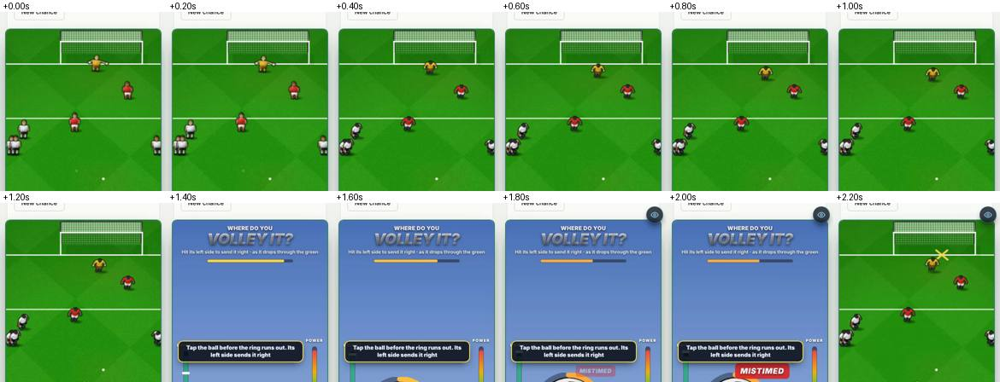
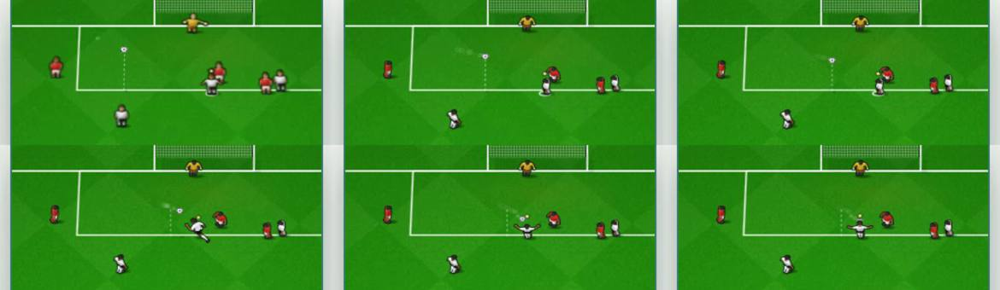
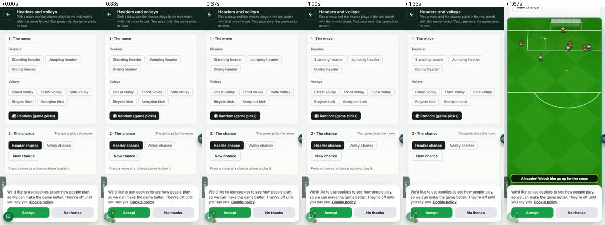

# Volleys and headers: what is wrong today (audit, 28 Nov 2026)

Harry, 28 Nov, 11:55: "gameplay wise there's some big issues rn: camera, volleys and headers, chance creation type … main starter being headers and volleys."
Then, 12:08: "the headers and volleys system just has never worked with WHEN you hit the ball."

What happened next: we did not patch the timing. We built five other ways to hit the ball, side by side, on the test page.
See `AERIALS_OPTIONS_2026-11-28.md`.

How this was checked:
- **Seen**: films at phone size (390 wide) on `/star-aerials-dev` (the real engine, through EnginePlay).
- **Measured**: scripts against the engine's own chance builders.
- **Reasoned**: from the code, where said.

Worst first.

## 1. You never see the cross arrive (seen + measured)

- The man who crosses it is never in the picture: he was outside the chance's frame in 500 of 500 header pictures and 500 of 500 volley pictures (`buildHeader` and `buildVolley` put him on the wing; the frame is the box).
- With no build-up before the chance, a **volley** gets no delivery at all. The ball sits still in the air at 0.95 m until the strike screen opens (`crossBallNow` only draws a cross for headers).
- With no build-up, a **header** shows only the last 0.35 s of its cross, and that part is slowed into a creep that never stops (`headerBeat.ts` `tailLeft`). It reads as a ball hanging in the air.
- Which chances have no build-up: the first chance of every match (`careerBuildUp` returns nothing for the opening chance), every test page, and the drills.

**Fix:** the five options in `AERIALS_OPTIONS_2026-11-28.md` all play the whole cross on the pitch, from the crosser, on one clock (`airLabNow` in CanvasMatch, test page only). It enters the frame about 0.6 s before it reaches you. The crosser himself is still off the frame; that is the camera's job.

## 2. The strike screen opens by itself, then hides the ball (seen)

- With no build-up, the "Head it?" / "Volley it?" screen opens on a fixed clock: 0.5 s, plus your move's rise (0.36 to 0.62 s), plus 0.1 s. After a build-up it is the rise plus 0.1 s.
- Filmed: the header screen opened 0.57 s after the first aim frame, the volley screen 1.15 s after. That was before the ball had visibly arrived anywhere.
- The screen covers the whole pitch. What you time is a ball looping on a blue screen, not the real cross. Its ring is a second clock.
- This is the root of "never worked with WHEN".

**Fix:** the options keep you on the pitch. The moment that counts is the real ball reaching you.

## 3. The kit man drill's throw and lob are never drawn (measured)

- Den stands 3.5 to 3.7 m from the ball (`drillScene.ts` `feederSpot`).
- A delivery is refused under 6 m (`airDrawings.ts` `airArrival`: `if (L < 6) return null`).
- So the header's cross is drawn coming from the scenario's own wing crosser, 30 m away and off the frame, at x 63.8 and y 6.1. Den is at x 30.8 and y 6.2.
- The volley and the half-volley get nothing: the ball hangs.

**Fix (not built yet):** a short delivery from a set point, at a slower hand-throw speed. Wait until Harry picks the control, then wire the drill to the same clock.

## 4. The coach box covers the ball (seen)

The first-chance coach line sits at 40% down the strike screen, over the ball you have to tap (the frame at +3.00 s in the film).
**Fixed for the test page's options:** it is hidden there. The ball screen itself is unchanged.

## 5. Outcome rates (measured; real numbers reasoned, not measured here)

Goals per 100 at Aerial 30 / 60 / 90, average bot thumb (`scripts/aerial/tap-measure.mts`):

| Chance | Aerial 30 | Aerial 60 | Aerial 90 |
|---|---|---|---|
| Header | 13 | 22 | 28 |
| Volley | 16 | 24 | 29 |

The game's ground shots, same bot (`scripts/b10/measure.mts others`): one-on-one 45, tight angle 23, long range 23.5.

Real football, from public shot data (not measured here): a header scores about half as often as a shot with the foot from the same spot, and a volley from the edge of the box scores well under one in ten.
So our volley, from 11 to 17 m, scores as often as a tight-angle shot. That is too often. The header is about right next to the game's own ground shots.

## 6. Not audited this round

- **Keeper against headers:** he stands 0.7 to 1.5 m off his line and reacts as to any shot. No header-specific reading was measured.
- **The camera:** on the test page the play fills the top quarter of a tall frame, and the men are about 10 px tall. The camera is another builder's lane.
- **Training drills and highlights:** these use the same code paths as above, so the same problems apply. They were not filmed.
